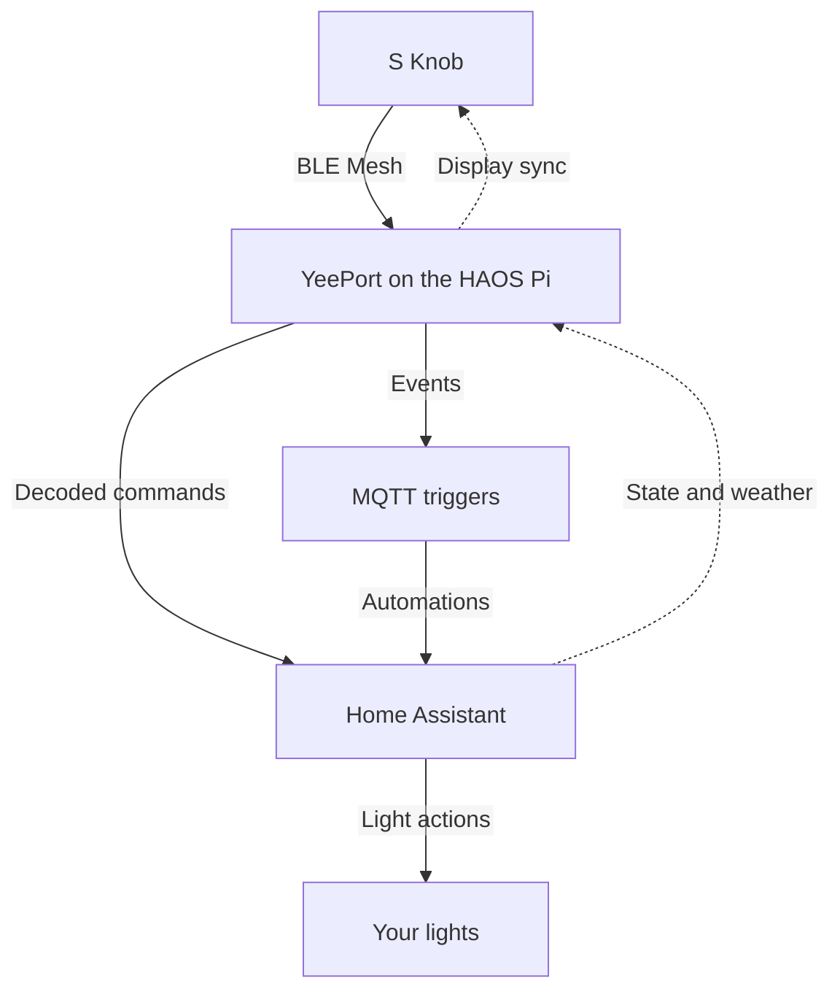
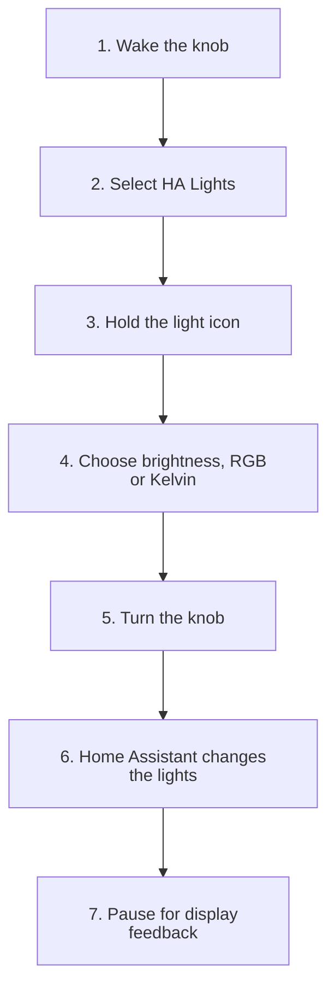
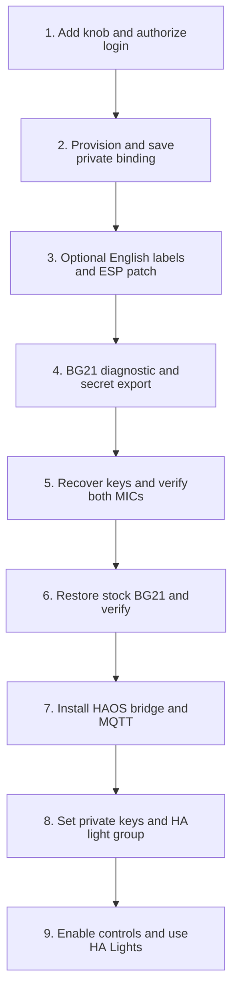

# YeePort

[](https://www.home-assistant.io/)
[](https://cn.yeelight.com/zh_CN/pro-detail?id=93)

YeePort connects a **Yeelight Pro S Knob** to **Home Assistant OS** over local
Bluetooth Mesh. Use the knob to control your HA lights' brightness, color and
white temperature, with English menus and local clock/weather updates.

Verified on one S Knob (product ID **1574912**, firmware **1.4.25**) and a
Raspberry Pi running HAOS. One-time setup used a Yeelight account; normal
operation uses your local HA/MQTT services. Other Yeelight Pro devices have
not been validated.

## Verified result

The owner confirmed that the knob's English **HA Lights** screen controls the
Home Assistant group `light.knob_lights`: brightness, on/off, RGB color and
Kelvin color temperature all work. On the knob, scroll to **HA Lights** and
hold its icon to open the controls. These controls were verified with 0.5.2;
the bridge release is now version 0.7.0.

### Separate brightness controls and a red preset

The owner's current configuration enables `separate_brightness_controls`:

Scroll to **RGB Lights** or **Warm White**, hold its icon to open the brightness
ring, then turn the knob. Press **Red 10%** to restore the preset.

| Entry | Action |
| --- | --- |
| RGB Lights | Set the selected RGB color's brightness while keeping the warm-white level. |
| Warm White | Set warm LED brightness while keeping the RGB level. |
| Red 10% | Activate the saved **Usual Red 10%** Home Assistant scene. |
| HA Lights | Control the whole group: on/off, brightness, RGB color, and white temperature. |

With `ha_lights_menu_enabled` enabled, **HA Lights** appears after Red 10%.
Hold its icon to open the full-color controls. Its brightness ring dims the
current RGB/white mix together; selecting RGB color clears white channels, and
selecting temperature switches to white mode. The separate rings then reflect
the resulting channel levels. All entries target the same `light_entity` group.

The scene is also available in Home Assistant as `scene.usual_red_10`.
`independent_channels` enables RGB + warm-white blending on the two Wiz lights.
The YN bar stays in RGB while RGB is above zero and switches to warm white when
RGB is zero, because its HA integration exposes separate modes. The red preset
sets RGB to 10% and warm white to 0%.

The owner confirmed both brightness rings work and RGB stays on while warm
white increases. The English entries, RGB commands and preset presses are also
confirmed in the live setup. With separate controls disabled, the original **HA Lights**
entry and full-color controls below remain available.

Color mode explicitly zeros RGBW/RGBWW white channels and preserves brightness.
Use its brightness ring to dim the selected RGB color; use temperature control
separately for warm/cool white lighting.

The bridge also publishes assignable English Home Assistant triggers for
authenticated knob light commands, synchronizes Bangkok time/date, and updates
outdoor temperature and available weather icons from Home Assistant. Optional
brightness speed scaling applies a linear Home Assistant-side ramp from 1× at
2 percentage points per second to a maximum gain of 4× at 12 points per second.
The scaling logic and curve were tested; the user's physical feel of that curve
has not been confirmed. The knob's own ring catches up to Home Assistant after
the turn ends. Haptic strength is not verified as configurable, and knob effects
are not implemented.

## How local control works



Solid arrows show control and event delivery. Dashed arrows show feedback to
the knob. The bridge authenticates both Mesh layers before acting on a command;
normal operation follows this local path without a Yeelight cloud connection.

### Using the HA Lights menu



1. Scroll to the English **HA Lights** entry.
2. Hold its icon to open the light controls.
3. Choose brightness, RGB color, or white color temperature, then turn the knob.
4. Home Assistant applies the change; the knob receives updated state when idle.

| Control | What changes |
| --- | --- |
| Brightness | Dims the selected color or white mode; 0% turns the lights off. |
| RGB color | Sets the color with warm/cool white channels off; preserves brightness. |
| White temperature | Selects warm/cool white lighting using Kelvin. |
| On/off | Controls the configured HA light group. |

## The setup journey we verified

The one-time setup has more steps than everyday use. This diagram records the
successful path on the tested unit; the [replication guide](docs/replication-guide.md)
contains its commands, private-file requirements and device-specific limits.



The knob has two processors: **ESP32-S3** handles its display, while **BG21**
handles Bluetooth Mesh. The English patch changed the ESP application; the
temporary key-export diagnostic changed BG21 and was then removed by restoring
stock BG21 firmware. Restoring BG21 preserved the English display.

**Firmware research is the difficult part.** The images and scripts are tied to
the exact 1.4.25 package and the tested unit. Recovery/rollback is unverified;
a failed BG21 update can remove BLE access. Each owner needs their own device
records and keys, and must review the hardcoded address guards before adapting
this setup. The guide records our successful procedure rather than presenting
an automatic installer for other knobs.

## Deployment and replication

The package and the setup's known limits are documented in
[the replication guide](docs/replication-guide.md). Home Assistant add-on
installation and controls are described in [the bridge guide](knob_bridge/DOCS.md).
This repository is a research implementation tied to one physical unit; it is
not a plug-and-play integration for arbitrary knobs. In particular, its
Bluetooth address is still fixed to the owner's device in several source files.

## Commands we used

For the Python tools, create a virtual environment and install the project and
bridge dependencies:

```sh
python3 -m venv .venv
.venv/bin/python -m pip install -r requirements.txt -r knob_bridge/requirements.txt
```

These are tested entrypoints from the project work. The first runs the local
unit suite; the next two build offline analysis artifacts and the last decodes
a private capture without contacting the knob or Home Assistant. Replace each
uppercase path placeholder with your own file path:

```sh
.venv/bin/python -m unittest discover -s tests -v
.venv/bin/python tools/prepare_knob_english_analysis.py OFFICIAL_1425_PACKAGE OUTPUT.analysis.bin
.venv/bin/python tools/prepare_bg21_key_export.py OFFICIAL_1425_PACKAGE OUTPUT.analysis.gbl
.venv/bin/python tools/decode_knob_mesh.py --keys PRIVATE_KEYS.json --capture PRIVATE_CAPTURE.jsonl --output PRIVATE_DECODED.jsonl
```

The dependency installation and public-source tests were checked in a fresh
virtual environment. Tests requiring private captures or an external firmware
reference skip when those inputs are absent. The full owner's 25-test suite
also passed. Firmware builders reproduced the exact candidate hashes used on
the device, and offline decoding revalidated all 57 brightness-capture packets.
These checks do not repeat firmware flashing.

The hardware and deployment command record is in the [replication guide](docs/replication-guide.md#recorded-command-entrypoints).

## Repository map

- `knob_bridge/` — Home Assistant add-on source, configuration defaults and
  user-facing installation guide.
- `docs/replication-guide.md` — what was verified, prerequisites, and the
  current device-specific and recovery limits.
- `docs/` — protocol investigation and dated research records. Some documents
  describe earlier stages and are historical; the verified current behavior is
  summarized above and in the replication guide.
- `tools/` — research, capture and device-maintenance tools. Several operate on
  the physical knob and are specific to the owner's unit; inspect their source
  before use.

The Home Assistant add-on retains its tested legacy name, **YeeGate S Knob**,
and slug `yeegate_knob`. These names are part of the working deployment and are
not a claim that this project implements a gateway emulator.

## Public release contents

Do not publish device firmware, generated vendor images, account responses,
provisioning captures, Bluetooth captures, logs, or credential/key files.
Use the repository's `.gitignore` and review every staged file before a public
release. Mesh keys and vendor account credentials are not included in this
repository; each owner must use their own credentials and device-specific keys.
